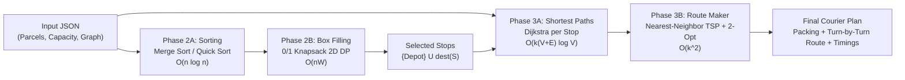

# Phase 1: Courier Problem Design and Planning

## 1. Problem Statement
Given a set of customer parcels $P = \{p_1, p_2, \dots, p_n\}$, a delivery vehicle with integer capacity $W$ (kg), and a weighted road network $G = (V, E, w)$ centered at a dispatch `Depot`, the **Intelligent Courier Planning System** produces:
1. A **prioritized parcel schedule** ordered by delivery SLA urgency, priority tier, and value density.
2. An **optimal vehicle packing plan** selecting a feasible subset $S \subseteq P$ such that $\sum_{p \in S} \text{weight}(p) \le W$ and $\sum_{p \in S} \text{value}(p)$ is maximized.
3. An **ordered closed delivery route** starting at `Depot`, visiting every unique destination $d \in \{\text{dest}(p) : p \in S\}$ via shortest road paths, and returning to `Depot`.

---

## 2. Data Design

### 2.1 Parcel Schema (`src/models.py :: Parcel`)
| Field | Type | Constraints | Purpose |
|---|---|---|---|
| `parcel_id` | `str` | Unique ID (e.g., `P001`) | Traceability across DP table and route |
| `destination` | `str` | Node ID in $V$ | Target customer stop on the graph |
| `weight` | `int` | $\ge 0$ (kg) | 0/1 Knapsack capacity constraint |
| `value` | `int` | $\ge 0$ | Objective reward maximized by DP |
| `deadline_hours` | `float` | $> 0$ | Primary sorting criterion (earliest first) |
| `priority` | `int` | $1 \dots 5$ ($5$ = urgent) | Secondary sorting criterion |

### 2.2 Graph Format (`src/graph.py :: DeliveryGraph`)
- **Input format**: JSON (`nodes`, `edges` as `{u, v, weight}`, `depot`, `directed` boolean).
- **Internal representation**: Adjacency list `dict[str, list[tuple[str, float]]]` supporting sparse road networks efficiently in $O(V + E)$ memory.
- **Constraint**: All edge weights $w(u, v) \ge 0$, satisfying Dijkstra's non-negative edge precondition.

---

## 3. Integrated Pipeline Architecture

---

## 4. Algorithm Selection & Suitability Justification

| Phase | Task | Selected Algorithm | Alternative(s) Compared | Time Complexity | Space Complexity | Why Selected |
|---|---|---|---|---|---|---|
| **2A** | Parcel Prioritization | **Merge Sort** | Quick Sort, Insertion Sort | $O(n \log n)$ worst-case | $O(n)$ | Guaranteed $O(n \log n)$ worst-case and **stable** ordering on equal keys. |
| **2B** | Vehicle Packing | **0/1 Knapsack (2D DP)** | 1D Space-Opt DP, Greedy Value/Wt | $O(nW)$ | $O(nW)$ / $O(W)$ | Guarantees **globally optimal** integer-weight value; Greedy fails on weight-packing traps. |
| **3A** | Point-to-Point Distances | **Dijkstra's Algorithm (Min-Heap)** | Bellman-Ford | $O((V+E)\log V)$ per stop | $O(V)$ | Optimal for sparse graphs with non-negative road distances. |
| **3B** | Delivery Tour Order | **Nearest-Neighbor TSP + 2-Opt** | Brute-force Exact TSP $O(k!)$ | $O(k^2)$ + 2-Opt | $O(k^2)$ | Exact TSP is NP-hard; NN gives fast $O(k^2)$ baseline and 2-Opt removes crossing edges. |

---

## 5. End-to-End Correctness & Integration Logic
1. **Sorting feeds Knapsack**: Sorting first guarantees deterministic tie-breaking in the DP backtracking phase and preserves an inspection-ready urgency table for operations teams.
2. **Knapsack filters Destinations**: Only stops belonging to `selected_parcels` enter the routing subgraph, avoiding wasted mileage to unchosen parcels.
3. **Dijkstra bridges Graph & TSP**: Real road networks are rarely complete graphs; running Dijkstra from each active stop constructs a metric shortest-path matrix so TSP transitions always expand into valid multi-hop road paths.
